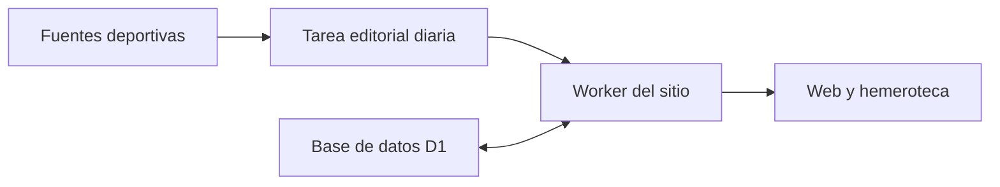

# Arquitectura, edición diaria y SEO

## Flujo de la aplicación

[generar.py](../generar.py) construye las plantillas HTML, el archivo de rutas, el índice inicial de búsqueda y los recursos SEO. [worker/index.js](../worker/index.js) sirve rutas, archivos y sesiones. [worker/editorial.js](../worker/editorial.js) inserta las publicaciones y los datos de D1 en las páginas al servirlas.

| Ruta | Contenido |
| --- | --- |
| `/`, `/actualidad/` | Portada y últimas publicaciones. |
| `/fichajes/`, `/entrenamientos/` | Cobertura temática y enlaces a fuentes. |
| `/partidos/` | Próximos partidos, resultados y descargas iCalendar con hora confirmada. |
| `/clasificacion/`, `/estadisticas/` | Tabla de la competición y datos por jugador. |
| `/hemeroteca/` | Búsqueda y filtros por tipo y mes de publicación, con paginación. |
| `/noticias/{slug}/` | Artículo con fecha, fuentes y URL canónica. |
| `/abonados/` | Acceso de demostración mediante sesión firmada. |
| `/sitemap.xml`, `/robots.txt` | Descubrimiento de URLs y reglas de rastreo. |

## Edición diaria

La tarea de producción está programada a las **09:00, hora de València**. Consulta el estado editorial antes de publicar. Revisa calendario, resultados, clasificación y estadísticas con Valencia CF, LaLiga o la RFEF. La cobertura editorial consulta además Superdeporte, Plaza Deportiva, MARCA Valencia y Deporte Valenciano. Las entrevistas de terceros se resumen y enlazan a la publicación original. Las columnas propias se identifican como opinión y citan las fuentes de los hechos.

La operación de publicación valida cada bloque antes de escribir. Una transacción registra la edición, los artículos y los bloques deportivos recibidos. Los bloques omitidos conservan el último corte comprobado. Los artículos se deduplican por tipo y fuente principal. Un reintento conserva la URL de la pieza publicada.

| Tabla D1 | Función |
| --- | --- |
| `editorial_articles` | Artículos, slug, categoría, fecha, fuente y texto. |
| `editorial_sports` | Cortes fechados de calendario, resultados, clasificación y jugadores. |
| `editorial_runs` | Fecha de las ediciones registradas. |

La [migración SQL](../drizzle/0000_ediciones.sql) define estas tablas. El agente publica mediante las operaciones editoriales del sitio. Cada edición modifica los datos y el Worker los sirve en las rutas públicas.

## SEO y acceso

Las páginas editoriales tienen títulos, descripciones y URLs canónicas. El código genera metadatos Open Graph y datos estructurados `WebSite`, `BreadcrumbList`, `Article` o `NewsArticle`, según la página. La hemeroteca y las publicaciones nuevas se incorporan al sitemap. La zona de abonados conserva `noindex` y la comunidad exige una sesión válida.

La fecha de publicación en SEMPRE AMUNT se muestra en la firma y en `datePublished`. La fecha de la fuente se presenta junto a su enlace cuando se conoce. Una revisión editorial sustancial registrada aparece en la firma y en `dateModified`. El `lastmod` de cada artículo refleja su publicación o su revisión. Las páginas generales omiten ese campo si carecen de una fecha fiable.

Cada página de hemeroteca sin filtros y con resultados declara su URL como canónica. `?pagina=1` redirige a `/hemeroteca/`. Las páginas fuera de rango devuelven `404`. Las búsquedas y filtros se pueden rastrear para que Google lea `noindex,follow`. Los artículos se enlazan desde la hemeroteca y el sitemap.

La propiedad de prefijo de URL se verificó en Google Search Console el **12 de noviembre de 2026**. El primer sitemap registrado ese día obtuvo el estado **Correcto**, con 13 páginas descubiertas. Tras incorporar la hemeroteca y cuatro piezas nuevas, el sitemap público sirvió 18 URLs. La indexación efectiva se consulta en el informe **Páginas** de Search Console.

## Compilación y producción

`npm run build` ejecuta el generador. Los recursos estáticos se preparan en `dist/client/` y el Worker compilado en `dist/server/index.js`. Las rutas dinámicas se entregan desde el Worker. `npm run dev` configura `noindex` para la vista previa local.

| Variable | Uso |
| --- | --- |
| `SITE_ORIGIN` | Origen canónico para metadatos, enlaces estructurados y sitemap. |
| `SITE_INDEXABLE` | Activa la indexación con `1` y configura revisión con `0`. |
| `MEMBER_PREVIEW_CODE` | Código de acceso a la demostración de abonados. |
| `EDITORIAL_OWNER_EMAIL` | Identidad autorizada para las operaciones editoriales. |
| `EDITORIAL_SERVICE_TOKEN` | Credencial del acceso autenticado de servicio. |

La vinculación al proyecto alojado, los secretos y el archivo de verificación de propiedad pertenecen al entorno de producción. La copia de clase incluye el código y el esquema SQL.

## Validaciones de referencia

- `npm run test:seo` comprueba las fechas visibles y estructuradas, la paginación con una segunda página real y que las URLs del sitemap devuelvan `200`, sean canónicas, indexables y estén enlazadas.
- En producción se comprobaron las rutas editoriales, los filtros de hemeroteca, las URLs canónicas, el sitemap y el acceso a la comunidad.
- La edición del 12 de noviembre incluyó calendario, resultados, clasificación y estadísticas, además de una noticia, una entrevista atribuida y una columna de opinión. Una prueba inmediata añadió una crónica del filial.
- Reenviar la misma edición dejó intactas las piezas publicadas. Los artículos y los datos siguieron disponibles tras actualizar el despliegue.
- La tarea diaria quedó activa. La comprobación registrada de publicación inmediata se realizó desde la conversación con acceso de servicio. La primera ejecución en segundo plano queda por verificar.
